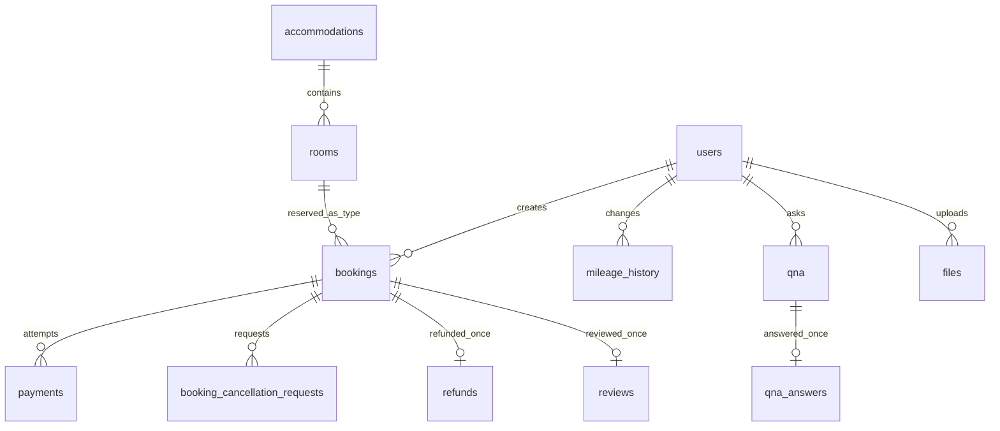

# DB 스키마 사전

[← 가이드 홈](README.md) · [예약 흐름](BOOKING_FLOW.md) · [Spring Boot 구조](SPRING_BOOT.md)

## 공통 규칙

- MySQL 테이블·컬럼: `lower_snake_case`, 테이블 복수형. PK/FK: `BIGINT`.
- 원화·마일리지: 소수점 없는 `BIGINT`. 상태: `VARCHAR`에 Java enum 이름 저장.
- 날짜만 필요한 예약 기간: `DATE`. 모든 처리 시각: `DATETIME(6)` UTC. 숙소 체크인·체크아웃 시각: `TIME`, 판단할 때 `Asia/Seoul` 사용.
- 예약·결제·환불 등 이력의 FK에 `ON DELETE CASCADE`를 사용하지 않는다. `RESTRICT/NO ACTION`을 기본으로 한다.
- `NN`=NOT NULL, `UQ`=UNIQUE, `PK`=기본키, `FK`=외래키. 별도 표시가 없으면 NULL 허용.

## 관계도



## 계정과 숙소

### `users`

| 컬럼 | 타입·제약 | 용도 |
|---|---|---|
| `user_id` | BIGINT PK | 사용자 번호 |
| `login_id` | VARCHAR(50) NN UQ | 로그인 아이디 |
| `password_hash` | VARCHAR(255) NN | 비밀번호 해시만 저장 |
| `name`, `nickname` | VARCHAR(50) NN / VARCHAR(50) | 이름 / 별명 |
| `email`, `phone` | VARCHAR(255) NN UQ / VARCHAR(20) | 이메일 / 연락처 |
| `role` | VARCHAR(20) NN | `ROLE_USER`, `ROLE_APPROVER`, `ROLE_ADMIN` |
| `status` | VARCHAR(20) NN DEFAULT `ACTIVE` | `ACTIVE`, `SUSPENDED`, `WITHDRAWN` |
| `token_version` | BIGINT NN DEFAULT 0 | 계정 상태가 바뀔 때 증가; 이전 Access Token 무효화 |
| `mileage_balance` | BIGINT NN DEFAULT 0 | 현재 잔액, 0 이상 |
| `profile_file_id` | BIGINT FK → `files.file_id` | 프로필 이미지; 파일 구현 단계에서 연결 |
| `created_at`, `updated_at` | DATETIME(6) NN | 생성·수정 시각 |

공개 회원가입으로 만들 수 있는 역할은 `ROLE_USER`뿐입니다. 승인자와 관리자는 관리자 작업 또는 초기 데이터로 부여합니다.
관리자 회원 API는 일반 회원을 `ROLE_APPROVER`로 지정하거나 다시 `ROLE_USER`로 돌릴 수 있습니다. `ROLE_ADMIN` 부여·변경은 이 API에서 허용하지 않습니다.
정지·탈퇴 시 Refresh Token은 폐기하며, 재활성화 후에도 이전 Access Token을 사용할 수 없습니다.

### `accommodations`

| 컬럼 | 타입·제약 | 용도 |
|---|---|---|
| `accommodation_id` | BIGINT PK | 숙소 번호 |
| `name`, `address` | VARCHAR(150) NN / VARCHAR(255) NN | 숙소명 / 주소 |
| `latitude`, `longitude` | DECIMAL(10,7) | 지도 좌표 |
| `description` | TEXT | 설명 |
| `check_in_time`, `check_out_time` | TIME NN | 숙소 현지 체크인·체크아웃 시각 |
| `status` | VARCHAR(20) NN DEFAULT `ACTIVE` | `ACTIVE`, `INACTIVE` |
| `created_at`, `updated_at` | DATETIME(6) NN | 생성·수정 시각 |

`host_id`는 없습니다. 숙소는 관리자 공용 데이터입니다.

### `rooms`

| 컬럼 | 타입·제약 | 용도 |
|---|---|---|
| `room_id` | BIGINT PK | 객실 **유형** 번호 |
| `accommodation_id` | BIGINT NN FK → `accommodations.accommodation_id` | 소속 숙소 |
| `name`, `description` | VARCHAR(100) NN / TEXT | 유형명 / 설명 |
| `price` | BIGINT NN | 1박 기준 원화 금액, 0 이상 |
| `capacity` | INT NN | 최대 인원, 1 이상 |
| `total_quantity` | INT NN DEFAULT 1 | 같은 유형의 판매 가능 객실 수, 1 이상 |
| `status` | VARCHAR(20) NN DEFAULT `ACTIVE` | `ACTIVE`, `INACTIVE` |
| `created_at`, `updated_at` | DATETIME(6) NN | 생성·수정 시각 |

한 숙소에서 `(accommodation_id, name)`은 유일하도록 둡니다.

## 예약과 취소

### `bookings`

| 컬럼 | 타입·제약 | 용도 |
|---|---|---|
| `booking_id` | BIGINT PK | 예약 번호 |
| `user_id` | BIGINT NN FK → `users.user_id` | 예약자 |
| `room_id` | BIGINT NN FK → `rooms.room_id` | 객실 유형 |
| `check_in_date`, `check_out_date` | DATE NN | 체크아웃 날짜는 숙박일에 포함하지 않음 |
| `guests` | INT NN | 예약 인원, 1 이상·객실 정원 이하 |
| `status` | VARCHAR(20) NN DEFAULT `PAYMENT_PENDING` | [예약 상태](BOOKING_FLOW.md#예약-상태) |
| `total_amount`, `used_mileage` | BIGINT NN / BIGINT NN DEFAULT 0 | 예약 당시 총액 / 사용 마일리지 |
| `payment_expires_at` | DATETIME(6) NN | 미결제 재고 점유 만료 시각 |
| `approved_by`, `approved_at` | BIGINT FK → `users.user_id` / DATETIME(6) | 승인자 / 승인 시각 |
| `completed_by`, `completed_at` | BIGINT FK → `users.user_id` / DATETIME(6) | **예약 완료** 처리자 / 시각. 승인 시 `approved_by`·`approved_at`과 동일하게 기록 |
| `cancel_source` | VARCHAR(20) | `USER_REQUEST`, `APPROVER_DIRECT`, `ADMIN_DIRECT`, `SYSTEM` |
| `cancel_reason_type`, `cancel_reason` | VARCHAR(30) / VARCHAR(255) | 취소 분류 / 설명 |
| `cancelled_by`, `cancelled_at` | BIGINT FK → `users.user_id` / DATETIME(6) | 실제 취소 처리자 / 시각 |
| `created_at`, `updated_at` | DATETIME(6) NN | 생성·수정 시각 |

검증: `check_in_date < check_out_date`, 금액 ≥ 0. `approved_by`·`completed_by`·`cancelled_by`의 **권한**은 FK로 보장되지 않으므로 Service에서 검사합니다.

### `booking_cancellation_requests`

| 컬럼 | 타입·제약 | 용도 |
|---|---|---|
| `cancellation_request_id` | BIGINT PK | 신청 번호 |
| `booking_id` | BIGINT NN FK → `bookings.booking_id` | 대상 예약 |
| `requested_by` | BIGINT NN FK → `users.user_id` | 신청 사용자, 예약자 본인 |
| `reason_type`, `reason_detail` | VARCHAR(30) NN / VARCHAR(255) | 사유 분류 / 설명 |
| `status` | VARCHAR(20) NN DEFAULT `REQUESTED` | `REQUESTED`, `APPROVED`, `REJECTED` |
| `decided_by`, `decided_at` | BIGINT FK → `users.user_id` / DATETIME(6) | 승인자·관리자 / 판단 시각 |
| `decision_reason` | VARCHAR(255) | 거절 등 판단 사유 |
| `created_at`, `updated_at` | DATETIME(6) NN | 생성·수정 시각 |

한 예약에 미처리(`REQUESTED`) 신청은 1건만 허용합니다. 신청은 예약을 바로 취소하지 않습니다.

## 결제와 환불

### `payments`

| 컬럼 | 타입·제약 | 용도 |
|---|---|---|
| `payment_id` | BIGINT PK | 결제 시도 번호 |
| `booking_id` | BIGINT NN FK → `bookings.booking_id` | 예약 |
| `payment_key` | VARCHAR(255) UQ | PG 결제 식별자 |
| `order_id` | VARCHAR(100) NN UQ | 서버 생성 주문번호 |
| `payment_method` | VARCHAR(30) NN | PG 결제수단 코드 |
| `paid_amount` | BIGINT NN | 마일리지 제외 실제 결제액 |
| `status` | VARCHAR(30) NN DEFAULT `READY` | `READY`, `PAID`, `PARTIALLY_REFUNDED`, `REFUNDED`, `FAILED` |
| `paid_at` | DATETIME(6) | 승인 시각 |
| `created_at`, `updated_at` | DATETIME(6) NN | 생성·수정 시각 |

예약 1건에 실패·재시도 결제 행은 여러 개 가능하지만 **성공 결제는 1건**만 허용합니다. 성공 시 `total_amount = paid_amount + used_mileage`를 검증합니다.

### `refunds`

| 컬럼 | 타입·제약 | 용도 |
|---|---|---|
| `refund_id` | BIGINT PK | 환불 번호 |
| `booking_id` | BIGINT NN FK UQ → `bookings.booking_id` | 예약당 환불 기록 1건 |
| `amount` | BIGINT NN | 정책으로 계산한 실제 원화 환불액 |
| `reason` | VARCHAR(255) | 취소 사유 |
| `status` | VARCHAR(30) NN DEFAULT `REQUESTED` | 신규 흐름: `REQUESTED`, `PROCESSING`, `REFUNDED`, `FAILED` |
| `started_at`, `processed_at` | DATETIME(6) / DATETIME(6) | 마지막 처리 시작 / 환불 완료 시각 |
| `failure_code` | VARCHAR(80) | 마지막 실패 원인 코드 |
| `auto_processing` | BOOLEAN | `TRUE`인 신규 자동 환불만 서버 재시작 후 복구 대상. 과거 수동 환불 행은 `NULL` |
| `processed_by` | BIGINT FK → `users.user_id` | 이전 수동 처리 기록 호환용. 자동 처리에서는 비어 있음 |
| `created_at`, `updated_at` | DATETIME(6) NN | 생성·수정 시각 |

기존 DB의 `APPROVED`, `REJECTED` 상태값은 과거 행을 읽기 위해 enum에 남겨 둡니다. 신규 자동 처리에서는 생성하지 않습니다. 원결제는 예약의 유일한 `PAID` 결제를 조회해 검증하며, 환불 재시도에는 같은 `refund_id`를 멱등키로 사용합니다. 사용한 마일리지는 PG 환불과 별개로 취소 시점에 잔액으로 되돌립니다(아래 `mileage_history`).

MySQL 프로필에서는 1분마다 `auto_processing = TRUE`인 건 중 1분 넘게 `REQUESTED`로 남은 건과 2분 넘게 `PROCESSING`에 머문 건을 최대 25건씩 복구합니다. `FAILED`는 자동 재시도하지 않으며 관리자가 원인을 확인한 뒤 재시도합니다.

2026-10-25 DB01 읽기 전용 확인에서 `status`가 이전 ENUM 형식이고 새 컬럼 3개가 없음을 확인했습니다. 배포 전 [수동 변경 SQL](../sql/2026-10-25-refunds-auto-processing.sql)을 적용해야 합니다. 이전 행의 `auto_processing`은 `NULL`로 두어 자동 복구 대상에서 제외합니다. 로컬 H2 테스트 통과만으로 DB01 스키마 변경을 검증한 것은 아닙니다.

### `mileage_history`

| 컬럼 | 타입·제약 | 용도 |
|---|---|---|
| `mileage_history_id` | BIGINT PK | 이력 번호 |
| `user_id` | BIGINT NN FK → `users.user_id` | 회원 |
| `booking_id` | BIGINT FK → `bookings.booking_id` | 관련 예약 |
| `type` | VARCHAR(20) NN | `EARN`, `USE`, `REFUND` |
| `amount`, `balance_after` | BIGINT NN | 증감량 / 처리 후 잔액 |
| `description` | VARCHAR(255) | 설명 |
| `created_at` | DATETIME(6) NN | 처리 시각 |

잔액과 이력은 같은 트랜잭션에서 변경합니다. `USE` 금액은 음수입니다.

마일리지는 **결제가 확정될 때** 차감합니다. 예약의 `used_mileage`는 쓰겠다는 신청이며, 예약 생성 시점에는 잔액이 줄지 않습니다. 결제하지 않고 버려진 예약을 되돌리는 흐름이 아직 없어, 예약 생성 시 차감하면 만료된 예약이 잔액을 영영 붙잡기 때문입니다. 취소 시에는 실제 차감 기록을 기준으로 되돌립니다. 예약당 `USE`와 `REFUND`는 각각 한 번만 남기므로 같은 처리가 다시 들어와도 잔액은 한 번만 움직입니다. 숙박 이용 완료에 따른 자동 적립은 [이용 완료 규칙](SPRING_BOOT.md)이 정해지지 않아 아직 없고, 적립은 관리자 수동 조정으로만 생깁니다.

DB01에는 이 테이블이 없으므로 배포 전 [수동 생성 SQL](../sql/2026-10-26-mileage-history.sql)을 적용해야 합니다. 저장소에 준비만 했으며 DB01에서는 아직 실행하지 않았습니다.

## 리뷰·문의·파일

| 테이블 | 컬럼·제약 | 핵심 규칙 |
|---|---|---|
| `reviews` | `review_id` PK, `user_id` FK NN, `booking_id` FK NN UQ, `accommodation_id` FK NN, `rating` INT NN, `content` TEXT NN, `is_deleted` BOOLEAN NN DEFAULT FALSE, `deleted_reason` VARCHAR(255), 생성·수정 시각 NN | 평점 1..5, soft delete. 리뷰 작성 가능 시점은 향후 **숙박 이용 완료** 규칙 확정 후 구현 |
| `qna` | `qna_id` PK, `user_id` FK NN, `title` VARCHAR(200) NN, `content` TEXT NN, `is_secret`/`is_deleted` BOOLEAN NN DEFAULT FALSE, `deleted_reason` VARCHAR(255), 생성·수정 시각 NN | 비밀글 본문은 작성자·관리자만 조회, soft delete |
| `qna_answers` | `answer_id` PK, `qna_id` FK NN UQ, `admin_id` FK NN, `content` TEXT NN, 생성·수정 시각 NN | Q&A당 관리자 답변 0..1개 |
| `files` | `file_id` PK, `uploaded_by` FK NN, `original_name`/`stored_name` VARCHAR(255) NN (`stored_name` UQ), `file_path` VARCHAR(500) NN, `mime_type` VARCHAR(100) NN, `file_size` BIGINT NN, `created_at` NN | 파일 메타데이터, 저장 위치는 웹 루트 밖 |
| `refresh_tokens` | `refresh_token_id` PK, `user_id` FK NN, `token_hash` VARCHAR(255) NN UQ, `expires_at`/`created_at` DATETIME(6) NN, `revoked_at` DATETIME(6) | Refresh Token 재발급·로그아웃용. 평문 저장 금지 |

이미지 연결은 `accommodation_files(accommodation_id,file_id)`, `room_files(room_id,file_id)`, `review_files(review_id,file_id)`, `qna_files(qna_id,file_id)`를 각각 복합 PK와 양쪽 FK로 둡니다. `files` 하나에 `owner_type/owner_id`를 넣는 방식은 실제 FK를 만들 수 없어 사용하지 않습니다.

숙소 이미지는 `accommodation_files`에 연결 순서(`display_order`)를 저장하고 첫 사진을 대표 이미지로 사용합니다. `file_id`에는 추가 고유 제약을 두어 한 파일을 여러 숙소에 연결하지 않습니다. 관리자 업로드·연결·해제 API와 공개 숙소 조회가 구현됐습니다. DB01에는 2026-10-26 [생성 SQL](../sql/2026-10-26-accommodation-images.sql)을 적용하고 컬럼·기본키·외래키·고유키를 확인했습니다.

객실 이미지도 `room_files`에 연결 순서(`display_order`)를 저장하며, 첫 사진이 숙소 상세의 객실 대표 이미지로 내려갑니다. `file_id`는 객실 사이에서 고유합니다. 관리자 API는 `POST /api/v1/admin/accommodations/{id}/rooms/{roomId}/images`와 `DELETE /api/v1/admin/accommodations/{id}/rooms/{roomId}/images/{fileId}`를 제공합니다. DB01에는 2026-10-26 [생성 SQL](../sql/2026-10-26-room-images.sql)을 적용하고 컬럼·기본키·외래키·고유키를 확인했습니다.

## 우선 생성할 인덱스

```text
rooms(accommodation_id, status)
bookings(room_id, status, check_in_date, check_out_date)
bookings(user_id, created_at)
booking_cancellation_requests(booking_id, status)
payments(booking_id, status)
refunds(booking_id UNIQUE, status)
reviews(accommodation_id, is_deleted, created_at)
qna(is_secret, is_deleted, created_at)
```
