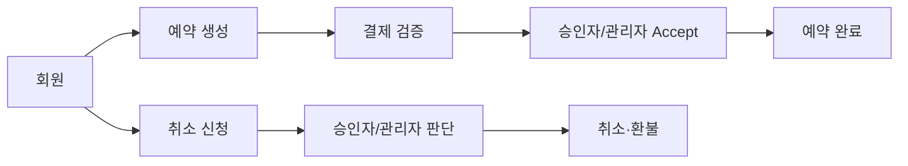

# StayBooking 개발 설계 가이드

> IntelliJ에서 `docs/architecture/README.md`를 열고 **Preview** 또는 **Editor and Preview**로 보면 됩니다.  
> 기준: 팀원의 DB 구조 설계 초안 + 2026-10-15에 확정한 예약·결제·취소 규칙.

| 읽을 문서 | 코딩할 때 확인할 내용 |
|---|---|
| [DATABASE.md](DATABASE.md) | 테이블·컬럼·FK·enum·인덱스 |
| [BOOKING_FLOW.md](BOOKING_FLOW.md) | 예약 재고, 결제, 승인, 완료, 취소, 환불의 상태 흐름 |
| [SPRING_BOOT.md](SPRING_BOOT.md) | Entity/Repository/Service/Controller 구성과 API 경로 |
| [DB_CONNECTION.md](DB_CONNECTION.md) | DB01 계정 준비와 WAS01 MySQL 연결 설정 |
| [원본 기준안](../staybooking-db-final-design.md) | 상세 결정 배경 및 전체 설명 |

## 개발의 중심 흐름



## 먼저 기억할 여섯 가지

1. `reservations` 대신 **`bookings`**를 사용한다.
2. `rooms`의 **한 행은 동일 유형 객실 여러 개**이며 `total_quantity`만큼 판매할 수 있다.
3. 결제가 끝나야 예약이 승인 대기(`PENDING`)가 된다. 결제 전은 `PAYMENT_PENDING`이다.
4. `ROLE_APPROVER`는 숙소 소유자가 아니다. 숙소·객실 관리는 `ROLE_ADMIN`만 한다.
5. 사용자는 취소를 **신청**한다. 승인자·관리자는 신청 처리와 직접 취소가 가능하다.
6. 승인 시 예약이 `COMPLETED`가 되며 `approved_by`와 `completed_by`에 처리자를 기록한다. 숙박 **이용 완료**는 아직 설계하지 않았다.

## PK·FK 이름을 읽는 법

```text
users.user_id      ← 회원을 구별하는 PK
bookings.user_id   → 예약자를 가리키는 FK (users.user_id 참조)
bookings.room_id   → 예약 객실 유형을 가리키는 FK (rooms.room_id 참조)
bookings.approved_by → 승인한 사람을 가리키는 FK (users.user_id 참조)
```

같은 대상을 뜻하면 같은 이름을 쓰고, `approved_by`처럼 **행위가 중요한 참조**는 행위를 이름에 표시합니다.

## 현재 프로젝트와의 관계

이 문서는 **목표 설계**입니다. 2026-10-26 DB01의 `staybooking` DB를 백업하고 `refunds` 타입·컬럼 변경, `mileage_history` 생성, `accommodations` 상세 컬럼 추가를 적용했습니다. 새 DB를 다시 생성하지 않습니다. 최신 WAR는 운영 Tomcat과 분리된 임시 포트에서 DB01 `ddl-auto=validate` 기동 검증을 통과했으며 운영 WAR는 교체하지 않았습니다. `spring.jpa.hibernate.ddl-auto=update`에 기존 컬럼 타입 변경을 맡기지 않습니다. Flyway는 현재 사용하지 않습니다.
